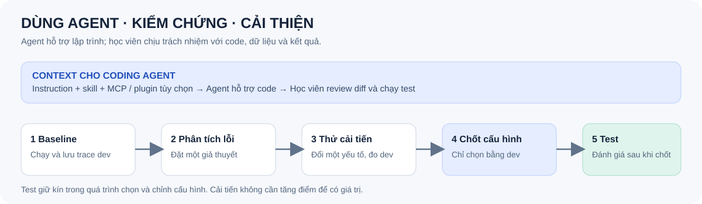

# Day 7 — Retrieval & Context Engineering: Từ câu hỏi đến bằng chứng

**Cá nhân · 4 giờ · Python 3.11+ · tiếp nối Day 6**

Bạn nhận đầu ra ingestion: chunks, metadata và benchmark. Hãy xây, so sánh ít nhất **ba chiến lược retrieval**, đóng gói kết quả thành context có thể truy nguồn, dùng dev để cải thiện một cấu hình và đánh giá trên test. Hãy sử dụng một coding agent như Codex, Claude Code hoặc Antigravity để hỗ trợ; bạn chịu trách nhiệm kiểm tra code và kết quả.

Đọc [RULES](RULES.md), [CHECKPOINTS](CHECKPOINTS.md), [GUIDE](GUIDE.md), [RUBRIC](RUBRIC.md), [SUBMISSION](SUBMISSION.md), [AGENT_SETUP](AGENT_SETUP.md) và [PSEUDOCODE](PSEUDOCODE.md). Báo cáo theo [mẫu cá nhân](report/individual/MSSV_HoTen.md). Có thể làm offline không API key; MCP/plugin là phần thực hành setup có phương án thay thế khi không truy cập được. Không cần chatbot hoặc LLM sinh câu trả lời.

## Pipeline: từ Day 6 đến context

Từ cùng một bộ chunks, chạy TF-IDF + cosine và BM25 độc lập; dùng RRF để gộp hai bảng xếp hạng thành chiến lược thứ ba. Mỗi chiến lược trả top-3 để đóng gói context và đo retrieval. Có thể thay TF-IDF bằng dense embedding thật; RRF kết hợp TF-IDF và BM25 là kết hợp hai phương pháp lexical.

## Vòng lặp thực hành với coding agent

Agent giúp xây và kiểm tra pipeline. Bạn đọc trace, thử cải tiến trên dev, chọn cấu hình rồi đánh giá test đã giữ kín. Instruction, skill, MCP và plugin được giải thích trong [hướng dẫn setup](AGENT_SETUP.md).

## Đầu ra bắt buộc

- Chuyển dữ liệu Day 6 sang contract trong `data/README.md`; giữ nguyên văn evidence và định danh nguồn/trang. Nếu không có Day 6, tự chuẩn bị corpus và benchmark theo GUIDE.
- Ba chiến lược có tên: BM25, TF-IDF + cosine, và RRF kết hợp hai bảng xếp hạng; hoặc dense embedding thật thay TF-IDF. Không gọi TF-IDF là semantic embedding. Giữ cùng corpus/chunks và so sánh công bằng.
- Context có nguồn, loại trùng, tuân thủ budget cố định; trace đủ để tính và kiểm tra metrics.
- Chốt baseline → phân tích dev → đề xuất và thử cải tiến có kiểm soát → chọn cấu hình theo dev → chạy test một lần. Cải thiện không bắt buộc có điểm cao hơn.
- Nộp code, dữ liệu được phép chia sẻ hoặc cách tái tạo, benchmark/gold, config, trace, nhãn và báo cáo; ghi cách dùng và kiểm chứng đầu ra agent.

## Bắt đầu

1. Fork hoặc clone repository đề bài và tạo repo cá nhân theo [SUBMISSION](SUBMISSION.md); mở thư mục này bằng agent bạn chọn.
2. Tạo môi trường Python và cài các thư viện bạn chọn; ghi phiên bản và lệnh trong README bài nộp. Dùng `data/example_*.json` chỉ để kiểm tra schema, không phải benchmark nộp bài.
3. Hoàn thành setup và kiểm tra agent theo [AGENT_SETUP](AGENT_SETUP.md), sau đó làm [GUIDE](GUIDE.md). Chạy `python -m unittest discover -s tests -v` để kiểm tra fixture và contract mẫu.
