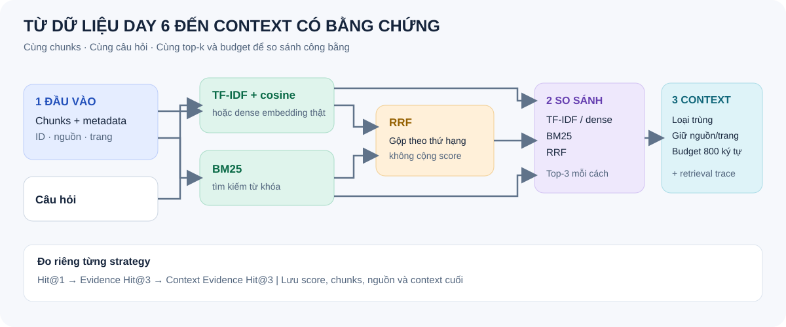
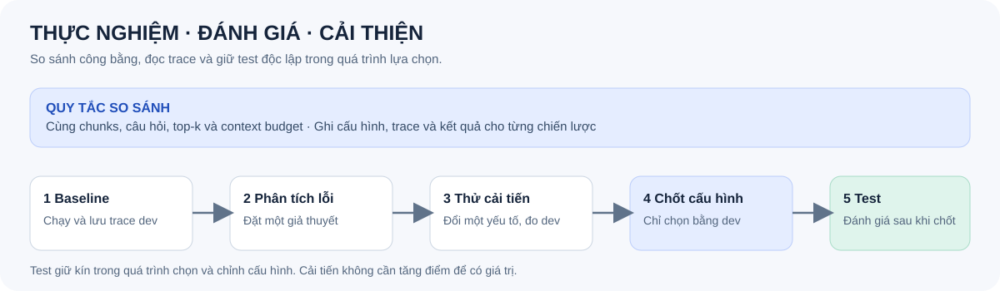

# Day 7 — Agentic RAG

**Bài cá nhân · 4 giờ · Python 3.11+ · tiếp nối Day 6**

Dùng lại kho vector từ Day 6 để xây agent biết tìm tài liệu, trả lời có nguồn hoặc nói rõ khi không đủ thông tin.

> **Tùy chọn:** Xem [gợi ý dùng AI để lập trình](AGENT_SETUP.md). Phần này không bắt buộc và không tính điểm.

## Bài cần làm

1. Kết nối lại dữ liệu, mô hình tạo vector và kho vector Day 6.
2. Xây agent dùng mô hình thật, có công cụ tìm tài liệu và trích dẫn nguồn.
3. So sánh tìm bằng vector, tìm theo từ khóa BM25 và kết hợp bằng RRF.
4. Đánh giá, tìm lỗi, thử cải thiện trên tập phát triển rồi chạy tập kiểm thử.

Chuẩn bị ít nhất **15 câu phát triển và 5 câu kiểm thử có đáp án**, thêm **2 câu mỗi tập không có đủ bằng chứng**. Xem [cách đánh giá](BENCHMARK.md).

## Bắt đầu

1. Đọc [hướng dẫn](GUIDE.md), [các mốc thực hiện](CHECKPOINTS.md) và [thang điểm](RUBRIC.md).
2. Tạo repo cá nhân theo [hướng dẫn nộp bài](SUBMISSION.md). Chuẩn bị kho Day 6 và mô hình có khả năng gọi công cụ.
3. Tham khảo [bộ khởi đầu](starter/README.md). Bạn cần tự nối mô hình và kho vector thật; bộ khởi đầu chưa phải lời giải hoàn chỉnh.
4. Chạy `python -m unittest discover -s tests -v`. Các phép thử dùng kết nối giả lập chỉ kiểm tra mã, **không phải kết quả đánh giá agent thật**.

## Nộp bài

Nộp mã, cách chạy, dữ liệu hoặc cách truy cập, bộ câu hỏi, kết quả từng câu, nhãn đánh giá và [báo cáo cá nhân](report/individual/MSSV_HoTen.md). Xem [danh sách nộp bài](SUBMISSION.md) và [quy tắc](RULES.md).
