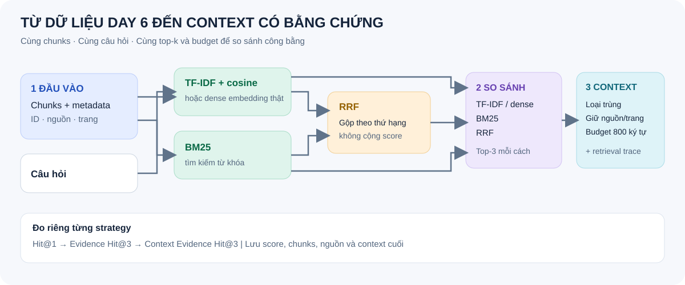
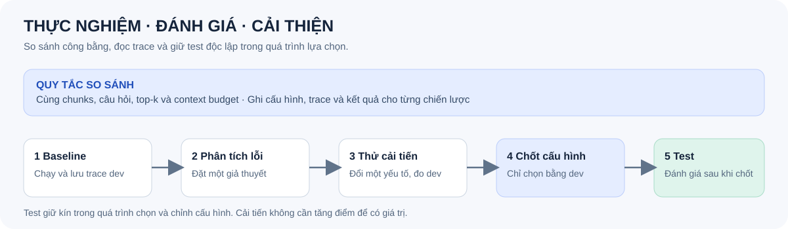

# Day 7 — Agentic RAG

**Bài cá nhân · Python 3.11+ · tiếp nối Day 6**

Dùng embedding và vector store từ Day 6 để xây một agent biết tìm bằng chứng, trả lời có nguồn và nhận biết khi không đủ thông tin. Bạn tự chọn kiến trúc, số tool và cách tổ chức retrieval.

> **Tùy chọn:** [Gợi ý dùng AI để lập trình](AGENT_SETUP.md) giúp bạn làm lab; phần này không bắt buộc và không tính điểm.

## Bài cần làm



1. Kết nối dữ liệu, embedding và vector store Day 6.
2. Xây agent dùng model thật và ít nhất một khả năng truy xuất dữ liệu. Agent có thể dùng nhiều tool và nhiều lượt gọi.
3. Thử **ít nhất 3 phương pháp retrieval khác nhau**, trong đó có dense retrieval dùng vector store Day 6. Tự chọn các phương pháp còn lại; xem [gợi ý](GUIDE.md#2-thử-các-phương-pháp-retrieval).
4. Thử nhiều cấu hình, benchmark, phân tích lỗi và chọn cấu hình tốt trên **dev**; sau đó đánh giá trên **test**.

Benchmark tối thiểu có **24 câu**: dev gồm 15 câu có đáp án và 2 câu thiếu bằng chứng; test gồm 5 câu có đáp án và 2 câu thiếu bằng chứng. Xem [benchmark](BENCHMARK.md) và [rubric](RUBRIC.md).

## Thử thách nâng cao · +15 điểm

Index một tài liệu thực tế từ **100 trang** có bảng, ảnh và biểu đồ; xây agent truy xuất và trả lời các câu hỏi về nội dung đó. Hoàn thành [thử thách nâng cao](ADVANCED.md) và đạt **ít nhất 90% benchmark test** để nhận 15 điểm bonus. Phần cơ bản tối đa 85 điểm; toàn bài tối đa 100 điểm.

## Bắt đầu

1. Đọc [hướng dẫn](GUIDE.md), [rubric](RUBRIC.md) và [quy tắc](RULES.md).
2. Tạo repo cá nhân theo [cách nộp bài](SUBMISSION.md), chuẩn bị đầu ra Day 6 và model hỗ trợ tool calling.
3. Dùng hoặc thay thế [starter](starter/README.md); bạn cần kết nối model và vector store thật.
4. Chạy `python -m unittest discover -s tests -v`. Test mock chỉ kiểm tra code, không phải benchmark agent thật.



Nộp code, cách chạy, cấu hình, benchmark, trace và [báo cáo](report/individual/MSSV_HoTen.md). Thời gian ở [checkpoints](CHECKPOINTS.md) là gợi ý, có thể điều chỉnh theo lớp và phạm vi thử nghiệm.

## Test UI

A local web page to try the agent: answer with clickable citations, status, source chunks, a tool-call timeline,
the final context, and tokens/latency. Python stdlib server plus plain HTML/CSS/JS, so it needs nothing beyond `requirements.txt`.

```powershell
.venv\Scripts\python app\server.py            # options: --port 8000  --no-warm
```

Open http://localhost:8000. Needs `.env` with `GEMINI_API_KEY` and the vector store (`python scripts/build_index.py`).
The server binds to 127.0.0.1 only and uses the same code path as `scripts/run_agent.py` (`src.agent.run_query`).
Each interaction trace is saved to `results/ui/<timestamp>.json` (git-ignored). Sample questions come from `benchmark/questions.json`
(textbook configs) or from the `examples` of your own document (below).

### Your own PDFs and the "All documents" library

Text PDFs (no OCR) can be added next to the textbook; the benchmark, `configs/final.json` and the `soc3e_B` index are
not touched.

```powershell
.venv\Scripts\python scripts\ingest_pdf.py C:\path\Dai-So.pdf --name dai_so --title "Đại số tuyến tính" --lang vi --math --skip-pages 1-5
# preview chunking without the model or the store:  ... --dry-run chunks_preview.json
```

This extracts text per page (with a fix for VnTeX PDFs whose copied accents are wrong), removes running headers and page
numbers, chunks by chapter/§ section (~1000 chars, 150 overlap), embeds with `intfloat/multilingual-e5-small` into the
Chroma collection `dai_so`, then rebuilds the **library** (`scripts/build_library.py`). Extracted text goes to
`data/local_docs/` (git-ignored).

The library is one Chroma collection (`library`, cosine) holding every document: the textbook chunks plus all ingested
PDFs, embedded with the same multilingual model, and one BM25 index over the same chunks. The UI's default search mode
**All documents** uses it: each question runs one hybrid search (cosine similarity + BM25, fused with RRF) over
everything, so the search, not a config, decides which document the answer comes from. The agent's prompt does not
name the documents and its search tool has no document or chapter filter; each retrieved chunk shows its document.
The benchmark configs (`final`, `base`, ...) are still listed under "Benchmark configs" and search their one collection.

Vietnamese text uses a syllable + syllable-pair BM25 tokenizer (the library uses a mixed English/Vietnamese one);
`--math` tells the agent that formulas were flattened by PDF extraction (`A−1` = A⁻¹, matrices as rows of numbers).
Sample questions for the UI: `"examples": [{"question": "..."}]` in `data/local_docs/<name>/collection.json`.
